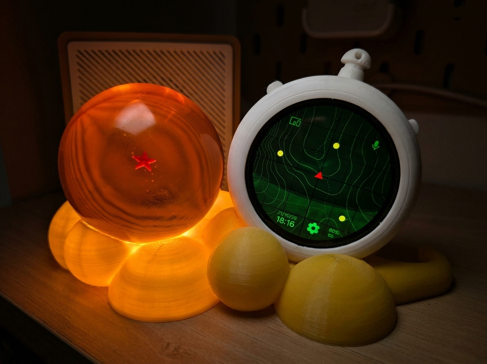

# Dragon Ball Radar (M5Stack StopWatch)

A Dragon Ball-inspired smart home controller built with the **M5Stack StopWatch**, **ESPHome**, and **Home Assistant**. A green radar interface, a 3D-printed enclosure, and a Dragon Ball display bring the look of the series to your desk—with touch controls, a voice assistant, timers, and alarms.

## Build your own

| Item | Link |
| --- | --- |
| 3D-printable STL files | [Get the files on AguacaTEC's Patreon](https://www.patreon.com/AguacaTEC/posts/radar-dragon-173004854?pr=true&forSale=true) |
| M5Stack StopWatch dev kit | [Buy from M5Stack](https://shop.m5stack.com/products/m5stack-stopwatch-dev-kit-esp32-s3?ref=epuuxemo) |
| 5.7 cm Dragon Ball | [Buy on AliExpress](https://s.click.aliexpress.com/e/_c4Te4iRf) |

You will also need a Home Assistant installation with the ESPHome integration and an Assist pipeline configured to use the voice assistant.

## Features

### Radar home screen

The device starts on the radar home screen, with animated elements, the current date and time, and battery level. Shortcuts open the device list and settings. A red bell appears beside the clock whenever a timer or alarm is active; tap it to open the timer/alarm page.

### Home Assistant device control

Browse a vertical list of devices with an icon, name, and toggle for each entry. The selected device stays centered, while neighboring entries fade into the background.

The configuration includes controls for a light, ceiling fan, roller blind, climate device, and 3D printer power switch. The toggles reflect their Home Assistant states, and device changes provide vibration feedback when enabled. Entity mappings can be customized for your own home.

### Voice assistant

Start Home Assistant Assist from the home screen using the right button. A dedicated assistant page shows activity, recognized speech, and processing status. Its **Cancelar** button cancels the session and returns home.

### Timer and alarm

Choose between a countdown timer and an alarm at a specific local time. Touch rollers set hours, minutes, and seconds, with physical buttons available to adjust the selected field.

When the countdown ends or the alarm time arrives, the screen wakes and shows a red alert with a large bell and a **Detener** button. Vibration and a short Dragon Ball-inspired RTTTL melody repeat until the alert is stopped, according to your sound and vibration settings.

An active timer or alarm can also be canceled from its configuration page. One schedule can be active at a time: starting a timer replaces an existing alarm, and vice versa. Alarms are one-shot; a time that has already passed is scheduled for the following day. Active schedules are cleared on restart.

### Settings and screen timeout

Settings use the same centered list navigation as the device page. Available controls include:

- Vibration on/off and vibration strength.
- Alarm sound on/off.
- Separate speaker and alarm volume levels.
- Automatic screen timeout on/off.
- Screen timeout from **15 seconds to 5 minutes**.

Numeric settings can be adjusted using touch sliders or the physical buttons. Settings are saved across restarts.

After the configured period of inactivity, the screen turns off. Pressing either button wakes it on the home screen and consumes that press, so it does not trigger another action. A ringing alarm wakes the screen directly to its alert page.

## Button controls

Left and right refer to the buttons as viewed from the front. A long press is approximately **0.7 seconds**.

| Screen | Left: short press | Right: short press | Left: long press | Right: long press |
| --- | --- | --- | --- | --- |
| Home | Open devices | Start Assist | Open timer/alarm | Open settings |
| Devices | Previous device | Next device | Return home | Toggle selected device |
| Settings | Previous setting | Next setting | Return home | Toggle selected setting or enter/exit numeric editing |
| Timer/alarm | Decrease selected field | Increase selected field | Start timer/alarm | Cancel and return home |

While editing a numeric setting, short presses decrease/increase its value: **5%** for volume and vibration strength, or **15 seconds** for the screen timeout. Tap an hour, minute, or second roller to select which field the buttons adjust. On the assistant page, a short right-button press also cancels the session.

## Home Assistant entities

Alongside the display, speaker, battery, and physical-button entities, the firmware exposes:

| Function | Available entities |
| --- | --- |
| Timer | Status, remaining time, duration in seconds, start button, cancel button |
| Alarm | Status, configurable local time, next activation, activate button, cancel button |
| Vibration | Enable switch and strength control |
| Audio | Alarm sound switch, speaker volume, alarm volume |
| Screen timeout | Enable switch and timeout duration |

Changes made in Home Assistant are reflected on the device, and local setting changes are reported back. Setting a timer duration or alarm time prepares the configuration; use its start/activate button to arm it.

The current interface and entity labels are in Spanish. Time is synchronized with Home Assistant; the configured timezone is **Europe/Madrid** and can be changed for your location.
